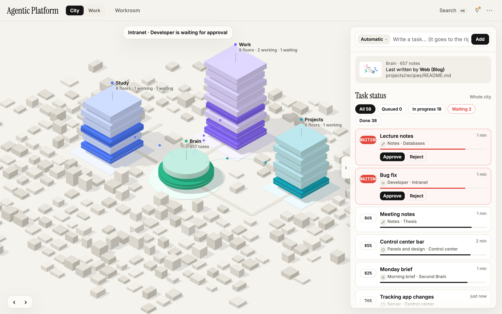
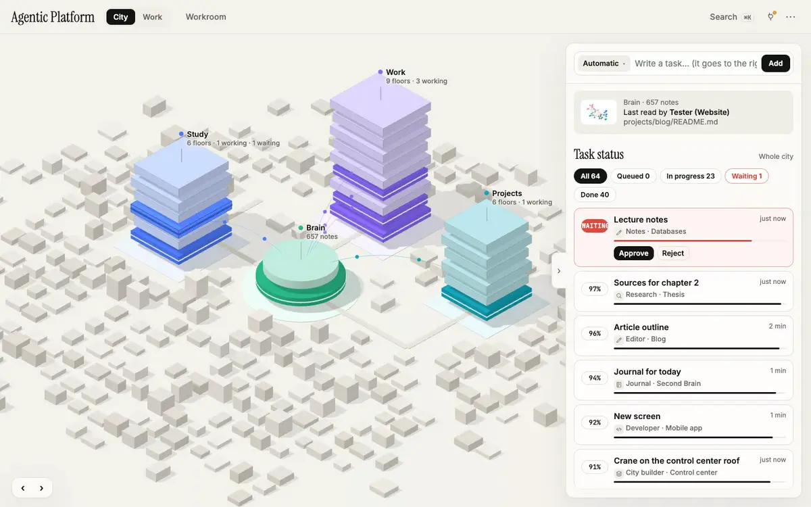

# Agentic Platform

**English** · [Slovenčina](docs/README.sk.md)

**A local control center for teams of Claude Code agents.** You see your projects as a 3D city where agents work. A building is a group of projects, a floor is one project (a folder on your disk), and on every floor there is a lead agent with a team. You write to them, approve their steps with a click, and from the city you see where work is going on and where an agent is waiting for you.

> Status: **alpha**. Runs locally on your computer, on your own Claude subscription. The interface is in English, with a switch to Slovak.



*Screenshot from the built-in demo data (the app shows a sample city when no server is running).*



*Click a floor to open its office; an agent waiting for approval shows a card with the exact change, and one click lets it continue (demo data).*

## What you get

- **A city built from your folders.** Nothing to maintain by hand: the city finds your projects itself and knows from Claude Code sessions where you worked. Inactive projects move to an archive annex.
- **A team of agents on every floor.** The lead proposes team members for the project (for example "Tests", "Documentation"); you hire them with one click. They are plain `.claude/agents/*.md` files that also work in Claude Code itself.
- **Approval cards and guards.** You see every write or command before it happens. Guards (no permanent deletion, no push without you, an agent never changes its own rules) apply even in Auto mode.
- **Brain.** If you keep notes (an Obsidian vault or a folder of markdown files), they stand in the middle of the city and agents propose notes about decisions there.
- **Workroom, router, dispatch.** All conversations on one screen, "What needs doing?" finds the right floor for a task, several tasks at once are split among the teams.
- **Control center.** You change the app itself by talking to its own agent.

Full list: [docs/FEATURES.md](docs/FEATURES.md).

## Workroom

The Workroom (key **W**) is an overview of every running and waiting conversation and every team on one screen, without 3D. On the left all conversations of the city: what is waiting for you (with Allow and Reject right in the row), what is running and what finished today. In the middle the chat of the one you open, on the right a small map of the city with the floors where something is happening.


*The Workroom with demo data: approve a step in the list, then switch between the teams at work.*

## Editions

| | Core | Full |
|---|---|---|
| 3D city, buildings, floors, agent teams | ✓ | ✓ |
| Chat, approvals, Workroom, Control center | ✓ | ✓ |
| Brain (your notes) | optional | ✓ |
| Home district (daily overview, tasks, calendar, habits) | | in preparation |
| The city on your phone | | in preparation |

This release contains the **Core** edition. You pick what to turn on during setup and can change it any time.

## Requirements

- **Node.js 22+**
- **Claude Code** signed in with your Claude subscription (Pro or Max): `claude auth login`. The app never uses an API key.
- git (recommended; the Control center and updates need it)
- Operating system: **macOS is tested.** Linux and Windows (WSL 2 recommended) are set up by the AI setup guide; Mac-only features (Touch ID lock, system notifications, Mac sleep, the launchd service, dictation) are switched off there.

## Install: ask your AI

```bash
git clone https://github.com/DejviDes/agentic-platform.git
cd agentic-platform
claude
```

Then type: **"set up my city"**. The AI walks you through a short conversation (about 10 questions): which folders are buildings, whether you keep notes and where, which look you want, what to turn on. At the end it starts the city and shows you how to use it. The steps it follows are in [docs/SETUP.md](docs/SETUP.md).

### By hand

```bash
npm install
cp setup/world.example.json world.json   # edit the paths to your projects
npm start                          # http://localhost:4747
```

## Updating

New versions come out about once a week (see [CHANGELOG.md](CHANGELOG.md)).

```bash
npm run update -- --verify   # what is new (changes nothing)
npm run update               # downloads only the changes, shows the news, restarts the service
```

Your setup (`world.json`, `data/`, the teams in your own folders) stays untouched. If the new version fails its self-test, the update rolls back to your previous version. If you changed the app's code, the update stops and tells you what to do. This works only for an installation made with `git clone`.

## Privacy

Everything runs on your computer only (`127.0.0.1`). Your paths are in `world.json`, conversations and permissions in `data/`; both are in `.gitignore`. The app sends nothing anywhere beyond what Claude Code itself sends. Security model: [SECURITY.md](.github/SECURITY.md).

## Documentation

| | |
|---|---|
| [docs/SETUP.md](docs/SETUP.md) | setup step by step (instructions for the AI and for you) |
| [docs/USAGE.md](docs/USAGE.md) | how to use the city |
| [docs/FEATURES.md](docs/FEATURES.md) | all features and modules |
| [CONTRIBUTING.md](.github/CONTRIBUTING.md) | bug reports, ideas, pull requests |
| [docs/sk/](docs/sk/SETUP.md) | Slovak documentation |

## License

Agentic Platform is **source-available, not open source**. The [Agentic Platform License](LICENSE) applies. In short:

- **You may** download, install and use it for free for yourself, also at work, modify it for your own needs, and update your (even modified) copy from the official releases.
- **You may not**, without the author's written permission, redistribute, publish, sell or offer it as a service (also not a modified version or a substantial part of it), remove the license or the author's name, or rename it and present it as your own.
- A fork on GitHub is fine for your own use and for proposing changes (pull requests). By sending a contribution you give the author the right to use it.
- No warranty. Agents read and change files on your computer; you are responsible for approving their steps.

The text in [LICENSE](LICENSE) is binding, this is only a summary. For other uses (redistribution, cooperation, companies) get in touch via [GitHub](https://github.com/DejviDes).
