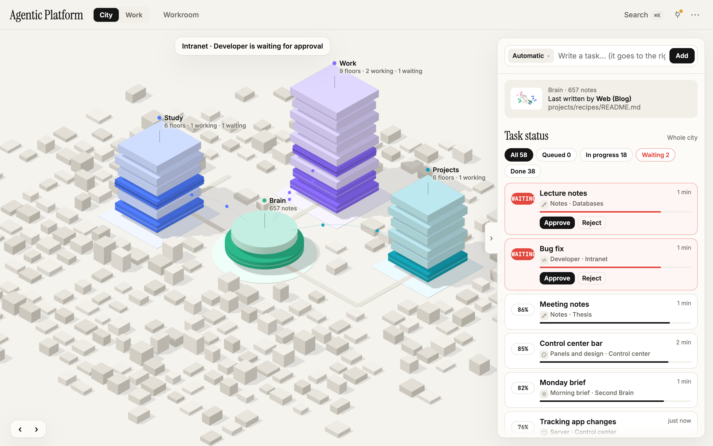
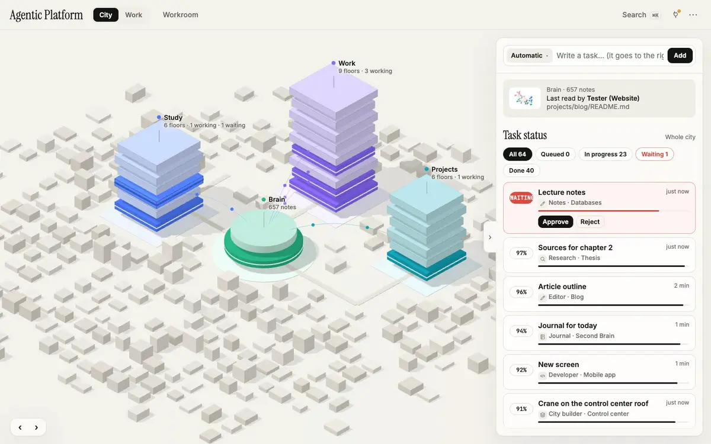

# Agentic Platform

[English](../README.md) · **Slovenčina**

**Lokálna riadiaca centrála pre tímy Claude Code agentov.** Tvoje projekty uvidíš ako 3D mesto, v ktorom agenti pracujú. Budova je skupina projektov, poschodie je jeden projekt (priečinok na disku) a na každom poschodí sedí vedúci so svojím tímom. Píšeš im, schvaľuješ ich kroky kliknutím a z mesta vidíš, kde sa práve pracuje a kde agent čaká na teba.

> Stav: **alfa**. Beží lokálne na tvojom počítači, na tvojom predplatnom Claude. Rozhranie je po anglicky s prepínačom do slovenčiny (Nastavenia › Vzhľad alebo `"language": "sk"` vo `world.json`).



*Snímka zo zabudovaných ukážkových dát (appka bez servera ukazuje ukážkové mesto).*



*Klik na poschodie otvorí kanceláriu; agent, ktorý čaká na schválenie, ukáže kartu s presnou zmenou a jedným klikom pokračuje (ukážkové dáta, rozhranie po anglicky).*

## Čo dostaneš

- **Mesto z tvojich priečinkov.** Nič neprepisuješ ručne: Mesto si projekty nájde samo a podľa sessions Claude Code vie, kde sa pracovalo. Neaktívne projekty idú do archívu.
- **Tím agentov na každom poschodí.** Vedúci ti navrhne zamestnancov podľa projektu (napr. „Testy“, „Dokumentácia“), prijmeš ich kliknutím. Sú to obyčajné súbory `.claude/agents/*.md`, fungujú aj v samotnom Claude Code.
- **Schvaľovanie kartami a poistky.** Každý zápis či príkaz vidíš vopred. Poistky (žiadne mazanie natrvalo, žiadny push bez teba, agent si sám nemení pravidlá) platia aj v režime Auto.
- **Mozog.** Ak máš poznámky (trezor Obsidianu alebo priečinok s markdown), sú v strede mesta a agenti do nich navrhujú zápisy rozhodnutí.
- **Pracovňa, router, dispečing.** Všetky konverzácie na jednej obrazovke, „Čo treba spraviť?“ ti nájde správne poschodie, viac úloh naraz sa rozdelí medzi tímy.
- **Riadiaca centrála.** Mesto si vieš upraviť rozhovorom s jeho vlastným agentom.

Celý zoznam: [docs/sk/FEATURES.md](sk/FEATURES.md).

## Pracovňa

Pracovňa (kláves **W**) je prehľad všetkých bežiacich a čakajúcich konverzácií a tímov na jednom mieste, bez 3D. Vľavo sú všetky konverzácie mesta: čo čaká na teba (s tlačidlami Povoliť a Zamietnuť priamo v riadku), čo beží a čo je dnes hotové. V strede je chat tej, ktorú otvoríš, vpravo malá mapa mesta s poschodiami, kde sa niečo deje.


*Pracovňa s ukážkovými dátami: krok schváliš v zozname a potom prepínaš medzi tímami, ktoré pracujú (rozhranie po anglicky).*

## Varianty

| | Základ | Plné |
|---|---|---|
| 3D mesto, budovy, poschodia, tímy agentov | ✓ | ✓ |
| Chat, schvaľovanie, Pracovňa, Riadiaca centrála | ✓ | ✓ |
| Mozog (tvoje poznámky) | voliteľne | ✓ |
| Štvrť Domov (osobný prehľad dňa, úlohy, kalendár, návyky) | | v príprave |
| Mesto v mobile | | v príprave |

Toto vydanie obsahuje variant **Základ**. Čo zapnúť, si vyberieš pri nastavení a kedykoľvek to zmeníš.

## Čo potrebuješ

- **Node.js 22+**
- **Claude Code** prihlásený tvojím predplatným Claude (Pro alebo Max): `claude auth login`. Mesto nepoužíva API kľúč.
- git (odporúčané; Riadiaca centrála a aktualizácie ho potrebujú)
- Systém: **macOS je otestovaný.** Linux a Windows (odporúčané WSL 2) nastaví AI sprievodca; veci iba pre Mac (zámok Touch ID, notifikácie systému, spánok Macu, služba launchd, diktovanie) sa tam vypnú.

## Inštalácia: povedz to svojej AI

```bash
git clone https://github.com/DejviDes/agentic-platform.git
cd agentic-platform
claude
```

A napíš: **„nastav platformu“** (funguje aj „nastav mi Mesto“ alebo po anglicky „set up the platform“). AI ťa prevedie krátkym rozhovorom (asi 10 otázok): ktoré priečinky sú budovy, či máš poznámky a kde, aký vzhľad, čo zapnúť. Na konci Mesto spustí a ukáže ti, ako sa ovláda. Postup, podľa ktorého ide, je v [docs/sk/SETUP.md](sk/SETUP.md).

### Ručne

```bash
npm install
cp setup/world.example.json world.json   # uprav cesty k svojim projektom, "language": "sk"
npm start                          # http://localhost:4747
```

## Aktualizácia

Nové verzie vychádzajú zhruba raz týždenne (zoznam je v [CHANGELOG.md](../CHANGELOG.md), po anglicky).

```bash
npm run update -- --verify   # čo je nové (nič nemení)
npm run update               # stiahne iba zmeny, ukáže novinky, reštartuje službu
```

Tvoje nastavenie (`world.json`, `data/`, tímy v tvojich priečinkoch) ostáva bez zmeny. Keď nová verzia neprejde skúškou, aktualizácia sa sama vráti na pôvodnú verziu. Ak si menil kód Mesta, aktualizácia sa zastaví a povie ti, čo s tým. Funguje to iba pri inštalácii cez `git clone`.

## Súkromie

Všetko beží iba na tvojom počítači (`127.0.0.1`). Tvoje cesty sú vo `world.json`, konverzácie a povolenia v `data/`, oboje je v `.gitignore`. Mesto neposiela nikam nič okrem toho, čo posiela samotný Claude Code. Bezpečnostný model: [SECURITY.md](../.github/SECURITY.md) (po anglicky).

## Dokumentácia

| | |
|---|---|
| [docs/sk/SETUP.md](sk/SETUP.md) | nastavenie krok za krokom (postup pre AI aj pre teba) |
| [docs/sk/USAGE.md](sk/USAGE.md) | ako Mesto používať |
| [docs/sk/FEATURES.md](sk/FEATURES.md) | všetky funkcie a moduly |
| [CONTRIBUTING.md](../.github/CONTRIBUTING.md) | hlásenie chýb, nápady, pull requesty (po anglicky) |

## Licencia

Agentic Platform je **source-available, nie open source**. Platí [Agentic Platform License](../LICENSE), v skratke:

- **Smieš** si ju zadarmo stiahnuť, nainštalovať a používať pre seba, aj v práci, upravovať ju pre vlastnú potrebu a aktualizovať aj upravenú kópiu z oficiálnych vydaní.
- **Nesmieš** ju bez písomného súhlasu autora ďalej šíriť, zverejňovať, predávať ani ponúkať ako službu (ani upravenú verziu alebo jej podstatnú časť), odstrániť licenciu či meno autora, ani ju premenovať a vydávať za vlastnú.
- Fork na GitHube je v poriadku na vlastné používanie a na návrhy úprav (pull request). Kto pošle príspevok, dáva autorovi právo ho použiť.
- Bez záruky. Agenti čítajú a menia súbory na tvojom počítači, za schvaľovanie ich krokov zodpovedáš ty.

Platí anglický text v [LICENSE](../LICENSE), toto je iba zhrnutie. Na iné použitie (šírenie, spolupráca, firma) sa ozvi cez [GitHub](https://github.com/DejviDes).
