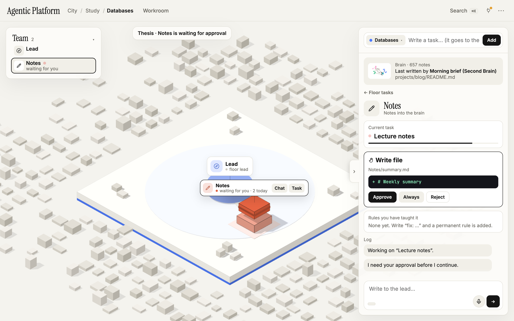
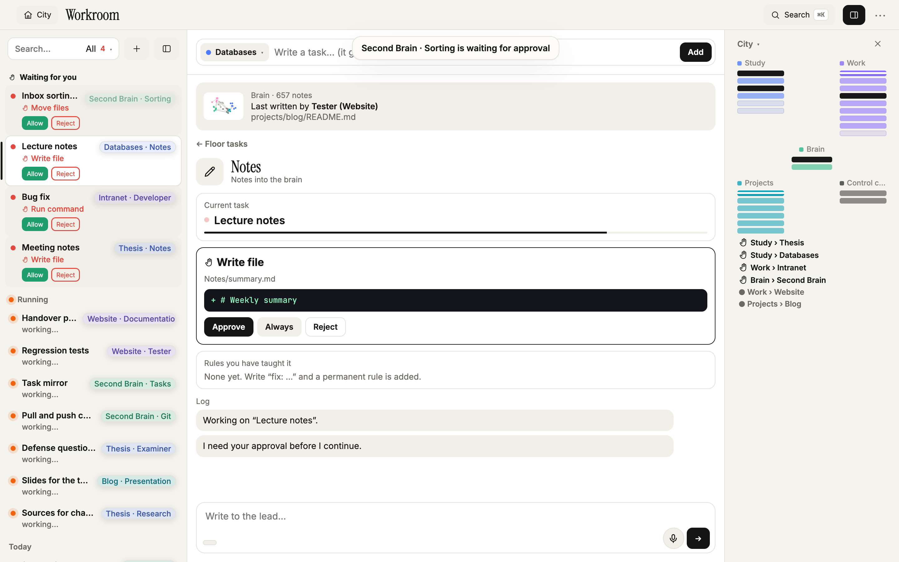

# How to use Agentic Platform

**English** · [Slovenčina](sk/USAGE.md)

## The city

- **Rotate and zoom:** drag with the mouse, zoom with the wheel. Hovering over a floor shows its name and recent conversations.
- **Buildings** are your groups of projects, **floors** are single projects. A floor where an agent is working pulses gently. When an agent waits for your approval, the floor gets a strong band and "waiting for you" lights up in the top bar.
- **Brain** (if you have one) is the building in the middle, key **G**.
- **Archive:** projects without activity sit in a low annex next to the building. When you start working in one, it returns to the tower.

## Office and chat

1. **Click a floor** to open its office: the lead in the middle, team members around.
2. Tell the lead what you need. The agent works directly in the project folder, like Claude Code.
3. **Approvals:** when the agent wants to write or run something, it shows a card with the exact step. Allow / Reject. For fewer clicks, switch the mode next to the message field:
   - **Ask**: you approve everything except reading,
   - **Edits without asking**: file writes go through, commands ask,
   - **Plan first**: the agent proposes a plan first and changes nothing,
   - **Auto**: the agent works on its own, the guards still apply.
4. **Model and effort** are also next to the message field. Higher effort = more thorough, but it uses more of your limit.
5. **Enter** sends the message, **⌘↵** sends it right away, even while the agent is working.

## Team

- Ask the lead to **"propose a team"**. It goes through the project and proposes team members with a card (name, role, what they do). You click Hire, Edit or No.
- Team members are plain files `.claude/agents/<name>.md` in the project; they also work in Claude Code itself.
- The lead sends them tasks on its own (delegation); you confirm model and effort with a card. You can also write to a team member directly (click them in the office).

## Memory and notes

- When a decision is made, the agent proposes a note with a card: a **rule** for the project's `CLAUDE.md` (how to work in the project) or a **note** for the Brain or the project folder. Nothing is written without your click.

## When you do not know where a task belongs

- **"What needs doing?"** in the city overview: type the task, the city suggests a floor and an agent.
- **Dispatch:** write several tasks at once, the city splits them and suggests a team for each. Start them all at once or keep them for later.

## Workroom (W)

All conversations of the city on one screen without 3D: on the left the list (waiting for you, running, recent), in the middle the chat. Good for longer work.

## Control center

The floor of the app itself. Tell its agent what you want to change in the city (for example "add a building for clients", "change the color of Projects", "I want a darker background"). You see the changes in the Control center bar and start commit and push with a click. When the server changes, the agent restarts it after your approval.

## Settings (⌘,)

Appearance (Layers or Classic city, larger text, language), notifications (sound, quiet mode, quiet until), usage and saving level, floor management (rename, hide, move), scheduled tasks. To change buildings and notes, say "change the city settings" in the Control center or in the app folder.

## Saving your subscription limit

- Use effort `medium` for normal work, `high` for hard things.
- Give small tasks to a cheaper model (Sonnet, Haiku).
- Rather end a long conversation and start a new one. You see the estimated cost at every message and the limits in the top bar.

## Keys

In the city: **G** Brain, **P** panel, **W** Workroom, **⌘K** search, **U** report a bug, **Esc** back, **?** shortcut line, **⌘,** Settings.
